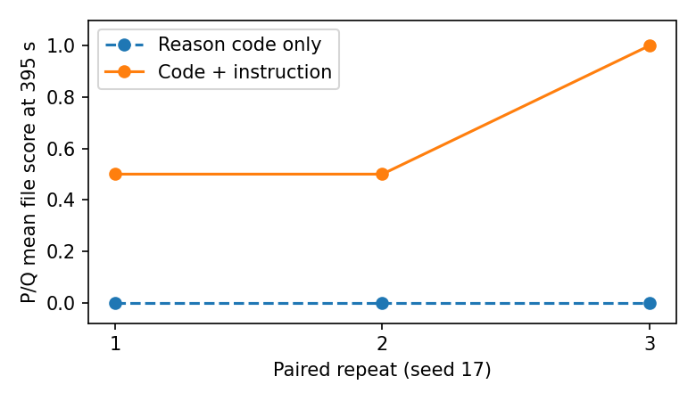

# P/Q 拒绝反馈配对实验

在同一条被拒绝的代码替换后，候选收到一句说明如何修正输入格式的指令，基线只收到原因码。按第 395 秒实际交付，候选 4/6 达到全局最优，基线 0/6。六次均在第一次作业完成，无缺测、无补跑。P 的最优成本为 80，Q 为 54。原始 ZIP、逐请求提示、模型输出、容器交付、超时状态和校验值均归档。[冻结协议](protocol.json) · [原始工件及清单](attempts/) · [逐次复评](trials.csv) · [实验运行](https://github.com/songconmaisaix31-design/ple-skill/actions/runs/45324245738) · [运行代码](https://github.com/songconmaisaix31-design/ple-skill/tree/33e9cf3e2338e0b140a5c9fb075d5de6b1ada172)

| 固定种子重复 | P 基线 | P 候选 | Q 基线 | Q 候选 | 跨题平均配对差 |
|---|---:|---:|---:|---:|---:|
| 1 | 0 | 1 | 0 | 0 | +0.5 |
| 2 | 0 | 1 | 0 | 0 | +0.5 |
| 3 | 0 | 1 | 0 | 1 | +1.0 |

三个重复中基线宏平均的均值和样本方差均为零，候选和配对差的均值均为 2/3、样本方差均为 1/12。按六个单题配对计算，差值样本方差为 4/15。两个统计量分别描述跨题重复和单题配对。

12 次均验证了源代码片段、相同的原生工具 schema、250 秒释放、固定种子 17、零温度、96 token 和 395 秒交付。两组各 6/6 收到登记反馈。候选在 39 次完成的调用中有 10 次返回无首尾空白的替换，10 次通过宿主检查，六次实验中有四次最终交付最优解。基线 59 次调用全部被拒绝。Q1、Q2 候选均通过了一次格式检查，但截止时缺少规定交付物。候选立即重试重复原动作 8/18 次，基线为 27/28 次。逐臂首次通过检查的时间见 CSV。仓库根目录运行 `python devtools/replay_actionable_feedback.py` 即可从原始 ZIP 重评。

**判定为继续复验。** 三次跨题差值均为正，P 和 Q 的平均差分别为 +1 和 +1/3。数据来自两份原创调度输入，使用同一个历史故障和同一种子；结论限于该条件。正式 PLE 开发集仍缺分，最近一次受限数据凭据交换返回 invalid_grant。[正式题记录](https://github.com/songconmaisaix31-design/ple-skill/actions/runs/45204574378/job/137796706042)
