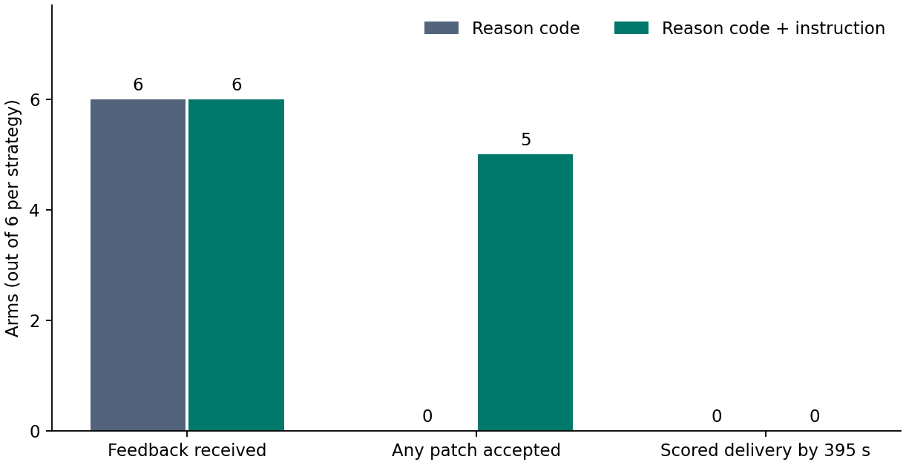

# T/U 未定义变量故障的独立复验

**停止将固定纠正句推广到不同故障。** 两份新输入上各完成三次同机配对，12 个实验臂在第 395 秒都没有产生输出目录，独立文件分均为 0。六次作业均在首次尝试上传了完整工件，无缺测或补跑。[冻结协议](protocol.json) · [原始工件及 SHA-256、作业编号](attempts/) · [GitHub Actions](https://github.com/songconmaisaix31-design/ple-skill/actions/runs/45337689208) · [运行与评分代码](https://github.com/songconmaisaix31-design/ple-skill/tree/c33fff94fc0572bbf13f2ac24919838d2329a0c8)

| 重复（种子 17） | T 基线 | T 候选 | U 基线 | U 候选 | 两题平均配对差 |
|---|---:|---:|---:|---:|---:|
| 1 | 0 | 0 | 0 | 0 | 0 |
| 2 | 0 | 0 | 0 | 0 | 0 |
| 3 | 0 | 0 | 0 | 0 | 0 |

T、U 各自的平均配对差均为 0。以三次跨题重复为单位，基线、候选及配对差的均值、样本方差（分母 2）均为 0。六个单题配对差的样本方差（分母 5）也为 0。[逐次文件复评分、失败原因、反馈和延迟](trials.csv)

历史首答第 81 行被有意改为引用未定义的泵量变量。两臂共享失败程序、五行源码、单行替换工具、宿主守卫、最多一次立即重试。唯一变量为拒绝原因码是否附带预登记的纠正句。A–S 为开发数据。T/U 输入及程序哈希、Gemma 4 26B A4B、温度 0、种子 17、96 token、250 秒释放、395 秒取样、720 秒名义预算和交替顺序见协议。离线负控两题均触发预期异常并得 0，宿主正控两题得 1，最优成本分别为 95 与 68。

| 观测 | 基线（原因码） | 候选（原因码加纠正句） |
|---|---:|---:|
| 实际收到规定反馈的臂 | 6/6 | 6/6 |
| 无首尾空白的替换 / 已完成工具调用 | 0/68 | 5/54 |
| 宿主接受的替换 / 已完成工具调用 | 0/68 | 5/54 |
| 已完成的立即重试中重复了被拒参数 | 33/33 | 19/25 |
| 截止时尚未完成的立即重试 | 2/35 | 4/29 |
| 至少一次替换获接受的臂 | 0/6 | 5/6 |
| 获接受替换的实际运行成功次数 | 无获接受替换 | 0/5 |

候选获接受的五次替换均将原来的变量改成另一个未定义的名字 `p_vals`，五次执行退出码均为 1。T3 的候选始终未通过宿主检查。12/12 实验臂的规定首答哈希、异常、源码片段、工具、一次重试、交付时刻及工件哈希已核验。候选在部分臂上修正了格式，仍未完成调度交付。三个重复的差值全部为 0，未达到预登记的三次均严格为正门槛。P/Q 和 R/S 的历史结果仍适用于原来的类型错误；本轮没有取得推广到该 NameError 的文件收益。

在仓库根目录运行 `python devtools/replay_actionable_feedback.py --name-error` 可由六个归档 ZIP 重建 CSV。每个 ZIP 包含原始提示词、完整返回的工具参数、结束及中断状态、文件清单、两臂报告。正式 PLE 开发题的 0/1 单题试跑和运行异常单独记录。[正式试跑](https://github.com/songconmaisaix31-design/ple-skill/actions/runs/45337685121/job/138253542503)
