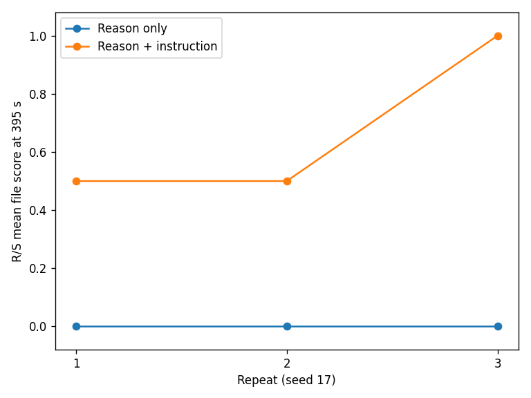

# R/S 独立复验

同一失败程序在两份新输入上各运行三个配对。Gemma 4 26B A4B、种子 17、温度 0、96 token、250 秒释放和 395 秒交付时刻均按协议固定。两臂只改变工具拒绝原因码后是否附带登记的纠正句。六次首次尝试均有效，十二个交付快照均独立复评。候选四次达到最优，基线六次未交齐文件。

| 重复 | R 基线 | R 候选 | S 基线 | S 候选 | 两题平均差 |
|---|---:|---:|---:|---:|---:|
| 1 | 0 | 0 | 0 | 1 | +0.5 |
| 2 | 0 | 1 | 0 | 0 | +0.5 |
| 3 | 0 | 1 | 0 | 1 | +1 |

R、S 的平均配对差各为 +2/3。以三个重复的跨题均分为单位，基线均值和样本方差均为 0，候选与配对差的均值均为 2/3，样本方差均为 1/12。以六个单题配对为单位，差值样本方差为 4/15。R 和 S 的满分交付成本分别为 79、89。

12 份记录均包含相同工具定义、规定的失败程序、源码片段、请求与实际响应。候选与基线各 6/6 收到本臂登记的反馈。候选 34 次返回中 9 次无首尾空白并通过检查，基线 62 次均未通过。R1 没有补丁获接受，S2 有一个获接受的补丁重新生成了原来的出错行，两者都缺少所需交付物。候选 13 次已完成的立即重试中 6 次重复原参数，基线 30/30。主分按截止点文件计算。失分及尚未返回的请求保留在工件内。

**继续跨故障验证。** 三个宏配对差均为正、两题均值非负，达到预登记门槛。R/S 和 P/Q 使用同一历史故障和同一种子，仍不能推断正式开发集收益。正式题数据访问已单独验证，正式分数待官方评分流程产出。

[原始 ZIP 及 GitHub 工件校验值](attempts/) · [逐臂分数及延迟](trials.csv) · [预登记](protocol.json) · [运行](https://github.com/songconmaisaix31-design/ple-skill/actions/runs/45330869706) · [运行与评分代码](https://github.com/songconmaisaix31-design/ple-skill/tree/96f19575311504ba4f4327e9ca6708bc3cd87a48)

从仓库根目录运行 `python devtools/replay_actionable_feedback.py --replication` 可由六份原始 ZIP 重新生成 CSV。无参数运行会复评 P/Q。
