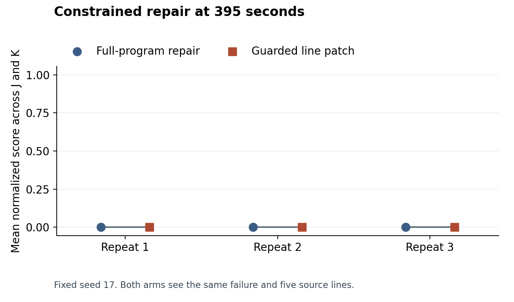

# J/K 受约束行补丁实验

结论：**停止提示词式 JSON 补丁候选，保留为失败基线。** 在第 395 秒，完整程序修复基线与受约束补丁候选的宏平均分均为 `0.0`；三次跨题配对差均为 `0.0`，配对差样本方差为 `0.0`。预登记的严格正收益门槛未达到。

本实验是原创故障恢复诊断，不是正式 PLE 开发集成绩。正式开发集仍没有可报告得分。

## 冻结设置

- 运行：[GitHub Actions 45267026840](https://github.com/songconmaisaix31-design/ple-skill/actions/runs/45267026840)
- 不可变运行提交：[`216e496d`](https://github.com/songconmaisaix31-design/ple-skill/tree/216e496da21863fd69fcdd347faa1ce753b13148)
- 协议：[protocol.json](protocol.json)，SHA-256 `c3e28dfac334d7ffe3298d5ae8f21250625ae21f56fcb935b045f049a59699e4`
- 输入：未见的 J/K；输入逐文件哈希写在协议中
- 模型：`google-cloud/gemma-4-26b`，温度 `0`，种子 `17`
- 时间：共同失败程序在 `t=250 s` 释放，真实文件在 `t=395 s` 冻结，名义预算 `720 s`
- 配对：每题三次，同机、独立模型进程和工作区，首臂交替
- 共同信息：两臂都收到完全相同的 TypeError、出错行及上下各两行
- 基线：现行完整程序修复，继承正常修复调用的 `max_tokens=8000`
- 候选：追加精确 JSON 行替换契约，`max_tokens=96`；宿主只允许替换第 81 行并重新解析完整程序

六个作业都在第一次尝试完成，离线传输、失败程序和正负补丁守卫均在模型启动前通过，没有技术补跑。

## 从文件独立重评

| 重复 | J 基线 | J 补丁 | K 基线 | K 补丁 | 跨题宏配对差 |
|---:|---:|---:|---:|---:|---:|
| 1 | 0.0 | 0.0 | 0.0 | 0.0 | 0.0 |
| 2 | 0.0 | 0.0 | 0.0 | 0.0 | 0.0 |
| 3 | 0.0 | 0.0 | 0.0 | 0.0 | 0.0 |

- 基线宏平均：`0.0`
- 候选宏平均：`0.0`
- 配对差均值：`0.0`
- 配对差样本方差：`0.0`
- J 平均配对差：`0.0`
- K 平均配对差：`0.0`

独立校验器重新生成 J/K 输入并核对哈希，只把第 395 秒工件中的 `schedule.csv` 和 `summary.json` 交给冻结评分器。12/12 臂重评分均为 0，且与运行时记录一致；所有输出目录在截止时都缺少完整的两个文件。



## 接口失败诊断

| 覆盖项 | 完整程序基线 | JSON 补丁候选 |
|---|---:|---:|
| 可重评实验臂 | 6/6 | 6/6 |
| 正确源码曝光 | 6/6 | 6/6 |
| 合法释放/派发时间 | 6/6 | 6/6 |
| 首个修复请求在截止前完成 | 0/6 | 6/6 |
| 完成的候选响应 | — | 24 |
| 非空 JSON 文本响应 | — | 0 |
| 被宿主接受的补丁 | — | 0 |

候选缩短响应上限后确实让 6/6 首个修复调用在截止前完成，但 Gemma 没有遵守文本 JSON 契约。24 个完成响应全部选择了通用 `run_python` 工具，均因 96 token 上限以 `finish_reason=length` 截断；可见文本为空。宿主守卫按协议拒绝全部响应，没有应用越权或不完整代码。这个结果说明“只在系统提示中声明局部补丁格式”不足以约束现有工具模型；它不说明局部编辑本身没有价值。

## 证据与复现

- [逐臂重评分](trials.csv)
- [统计摘要](summary.json)
- [提示、返回代码哈希与覆盖检查](code-coverage.json)
- [规范化证据包](evidence.zip)，SHA-256 `8b37246d572531cd2b0656acbd294c6c34dc466629b1b205e0f05d29f5cf1782`
- [六个原始 Actions 工件及哈希](attempts/attempts.json)

```bash
PYTHONPATH=devtools python devtools/verify_constrained_patch_evidence.py \
  --archive docs/experiments/constrained-patch-v1/evidence.zip \
  --protocol docs/experiments/constrained-patch-v1/protocol.json \
  --settings-protocol docs/experiments/repair-source-v1/protocol.json \
  --csv /tmp/jk.csv --details /tmp/jk-coverage.json

python devtools/constrained_patch_report.py /tmp/jk.csv \
  --output /tmp/jk-summary.json --plot /tmp/jk.png
```

`evidence.zip` 保留实际提示、模型可见返回、补丁判定、输入、截止时交付物和运行记录。生成的模型代码只做哈希、语法与结构检查，不在重评机上执行。
