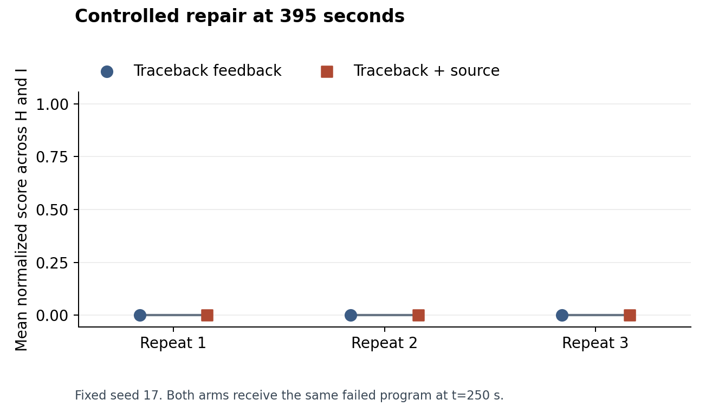

# H/I 受控修复源码反馈实验

## 结论

停止“在现行修复消息后附上出错行及上下各两行”这一候选，保留现有 `text` 首轮 Python 策略。

H/I 六个同机配对、十二个实验臂均在第 395 秒形成可独立复评的观测。基线和候选的宏平均分都是 `0.0`，三次重复的配对差均为 `0.0`，配对差样本方差为 `0.0`。候选 6/6 实际收到正确源码片段，基线 0/6 收到；两臂都在 6/6 任务中发出了修复请求，但第二次模型调用在截止前完成的次数均为 0/6。预登记的继续门槛要求三次宏配对差全部严格大于 0，因此判定为 `stop_candidate_no_gain`。

这个结论限于实际交付口径：Gemma 4 26B A4B 在第 250 秒收到故障后，剩余约 145 秒内没有返回完整修复响应，因而没有交付文件。实验不能说明“模型完成修复时源码片段是否提高正确率”；它说明该提示增量在当前模型、CPU 和 395 秒预算下没有改善交付。



## 冻结设置与结果

| 项目 | 冻结值 / 结果 |
|---|---|
| 输入 | 新留出 H/I；协议内保存逐文件 SHA-256 |
| 模型 | `gemma-4-26b`，Gemma 4 26B A4B GGUF |
| 采样 | 温度 0，种子 17 |
| 共同首答 | 历史 D 的真实失败 Python 程序；注释剥离后源码 SHA-256 `f4ece9d6d7e41e93f364db640b51b50c12c947ce1639fd2af991007dd76364f2` |
| 时间 | 第 250 秒释放共同首答；第 395 秒从容器导出文件；名义预算 720 秒 |
| 重复 | 每题 3 次，同机配对并交替先后顺序 |
| 基线 | 现行异常和 traceback 反馈，不附源码 |
| 候选 | 仅追加出错行上下各两行、行号和最多 800 字符的源码片段 |
| 基线分数 | 平均 `0.0`，样本方差 `0.0` |
| 候选分数 | 平均 `0.0`，样本方差 `0.0` |
| 配对差 | 平均 `0.0`，样本方差 `0.0`；H/I 各 0 胜 3 平 0 负 |
| 修复完成率 | 基线 0/6；候选 0/6 |

逐臂原始分数和定时见 [trials.csv](trials.csv)，汇总统计见 [summary.json](summary.json)，完整请求、模型返回、输入和截止时交付物见 [evidence.zip](evidence.zip)。正式 PLE 开发集仍未取得分数，本报告只属于原创诊断。

## 运行与尝试记录

主分析使用两份冻结运行提交：

- [`55a02ad1`](https://github.com/songconmaisaix31-design/ple-skill/commit/55a02ad1bbd3f2afd6d29869e8797a9b879c51e0) 的 [run 45246424026 / I3](https://github.com/songconmaisaix31-design/ple-skill/actions/runs/45246424026/job/137944248563)；
- [`de4be676`](https://github.com/songconmaisaix31-design/ple-skill/commit/de4be67625116a599f8c5d39d3eb10ed117db03c) 的 [run 45247679226](https://github.com/songconmaisaix31-design/ple-skill/actions/runs/45247679226)，其中首次 H1 超时取消，只重跑 [H1 job 137973972058](https://github.com/songconmaisaix31-design/ple-skill/actions/runs/45247679226/job/137973972058)。

更早的缺失证据包、协议读取错误、HTTP/2 下载中断，以及未纳入主分析的重复 I3 都保存在 [attempts.json](attempts/attempts.json) 和原始作业 ZIP 中。没有根据分数选择重跑或工件。

记录器在实验后把冗余 `first_mode` 字段写成了唯一脚本首答记录数组。原始 Actions ZIP 保持不变；[corrections.json](corrections.json) 逐臂保存原始 ZIP 哈希、字段修复前后哈希和严格匹配依据。构建器只有在错误值与 `model-io.jsonl` 中唯一的脚本首答逐字相等时，才按预登记顺序恢复该字段；其他证据字节不变。

## 从文件复评

在仓库根目录运行：

```bash
out=docs/experiments/controlled-repair-replay-v1
python devtools/verify_controlled_repair_evidence.py \
  --archive "$out/evidence.zip" --protocol "$out/protocol.json" \
  --settings-protocol docs/experiments/repair-source-v1/protocol.json \
  --expected-sha 55a02ad1bbd3f2afd6d29869e8797a9b879c51e0 \
  --expected-sha de4be67625116a599f8c5d39d3eb10ed117db03c \
  --csv /tmp/hi-trials.csv --details /tmp/hi-code-coverage.json
python devtools/controlled_repair_report.py /tmp/hi-trials.csv \
  --output /tmp/hi-summary.json --plot /tmp/hi-paired-scores.png
```

关键文件 SHA-256：

| 文件 | SHA-256 |
|---|---|
| `evidence.zip` | `5a0ee90a77cec4288396a012297c99def552a7aefd64edd2f33873f9df53d096` |
| `trials.csv` | `e9fd75b2b21afa2513af41865afcb77056f0293531b5f5b8d39d1f1abad386b3` |
| `summary.json` | `dea7af794a1143458245f0ee7628c5991c5c55c235e0765306073ee1c585b160` |
| `paired-scores.png` | `2bf34f44082a8a798f5adedb64a05fd27ed1d8afc47bdb19608a911bb3325dd9` |
| `corrections.json` | `8fce4effaff018b3d77d4fd7e6d6912dc73dab7e823ebad1e79b79612e1dc8fd` |

## 下一步依据

本轮的限制因素是修复响应延迟，而非源码片段是否送达。下一轮只测试一个小模块：双方都得到相同五行源码，基线等待完整程序重写，候选只返回并应用一个受约束的局部行替换，再执行完整程序。该设计借鉴 SWE-agent 的受约束编辑接口和 Agentless 的定位—补丁—验证分解；若补丁接口不能在新输入上提高 395 秒实际交付，则停止修复链改造，回到首轮程序策略。

