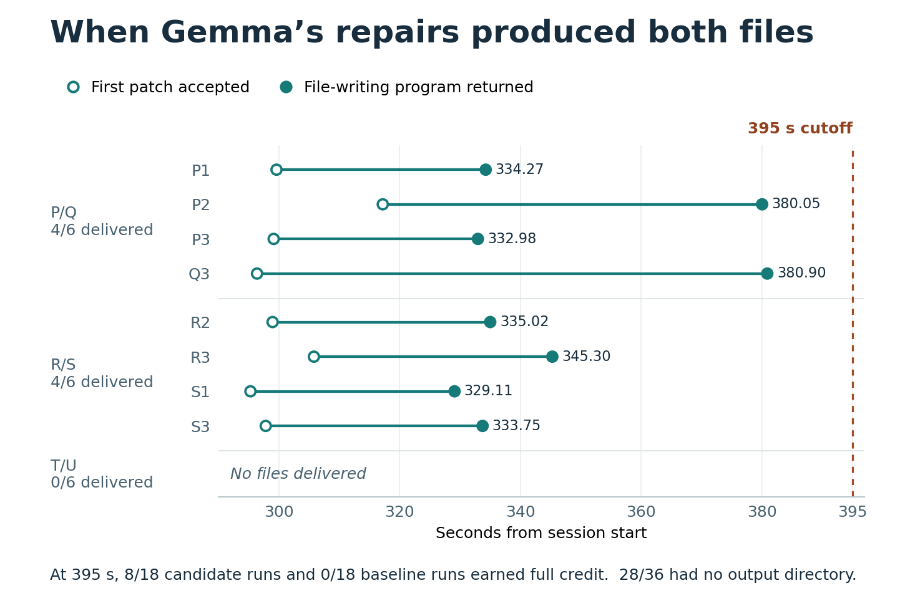

# Gemma 的补丁何时写出了可评分文件？

18 次候选运行中，16 次至少有一个补丁通过宿主检查，8 次在第 395 秒交付了全局最优的 `schedule.csv` 和 `summary.json`。这 8 次的首个获准补丁运行后都触发了 `TypeError`。直到第二个获准补丁，程序才成功写完两份文件。从首次获准到成功程序返回，中位数为 35.98 秒，范围为 33.80–84.50 秒。[逐臂记录（36 行）](trials.csv)

| 故障与输入 | 基线达到最优 | 候选有补丁获准 | 候选达到最优 | 候选无输出目录的实测原因 |
| --- | ---: | ---: | ---: | --- |
| `TypeError`，P/Q | 0/6 | 6/6 | 4/6 | Q1、Q2 获准后仍对整数取下标 |
| `TypeError`，R/S | 0/6 | 5/6 | 4/6 | R1 没有补丁获准，S2 获准后仍对整数取下标 |
| `NameError`，T/U | 0/6 | 5/6 | 0/6 | T3 没有补丁获准，其余五次均改成了未定义的 `p_vals` |

18 次基线均只收到拒绝原因码，所有修补建议都未通过宿主检查，截止时均无输出目录。候选在原因码后多收到一句固定的纠正指令。固定种子、相同输入的重复运行衡量的是这一受控条件下的交付。P 至 U 都是自建调度题。每次先由宿主在第 250 秒释放共同的失败程序，后续单行补丁由真实 Gemma 4 26B A4B 生成。此次复核使用三项既有实验的归档，无新增推理。[P/Q 原始记录](../actionable-feedback-v1/README.md) · [R/S 原始记录](../actionable-replication-v1/README.md) · [T/U 原始记录](../actionable-name-error-v1/README.md)

## 成功程序的返回时间



| 候选运行 | P1 | P2 | P3 | Q3 | R2 | R3 | S1 | S3 |
| --- | ---: | ---: | ---: | ---: | ---: | ---: | ---: | ---: |
| 写完两份文件的程序返回（自会话开始，秒） | 334.27 | 380.05 | 332.98 | 380.90 | 335.02 | 345.30 | 329.11 | 333.75 |

`first_accepted_s` 取自模型转录中的补丁接受事件，精确到 0.001 秒。`file_writing_exec_return_s` 取自同一会话单调时钟上的沙箱执行完成记录，四舍五入至 0.01 秒。八次成功运行都执行了同一哈希的修复后程序。该程序关闭两份文件后才打印成功回执。复核器匹配模型工具调用 ID、下一次请求中的回执以及对应执行的退出码。该动作的返回给出了文件写完时间的上界，记录的舍入误差为半个百分之一秒。记录未提供各文件关闭的精确时间。

`score_at_395` 只计第 395 秒冻结的实际交付文件。快照读取可以在截止后结束，采集器用目录、文件的变更时间和读取前后状态验证截止点一致性。评分器从 ZIP 中取出实际字节，独立复算可行性与最低成本。其余 28 次均已测得目录缺失、得分为 0，时间字段留空。原始模型转录位于各 ZIP 相应臂的 `model-io.jsonl`，沙箱动作、快照和文件清单位于 `report.json`。[采集器](../../../devtools/run_design_regression.py) · [独立复核器](../../../devtools/replay_delivery_today.py)

从仓库根目录运行以下命令可比对所有 36 行。安装 matplotlib 后，运行 `python devtools/plot_delivery_timing.py` 可从该 CSV 重绘上图。

```sh
python devtools/replay_delivery_today.py | diff -u docs/experiments/delivery-timing-2026-11-24/trials.csv -
```
