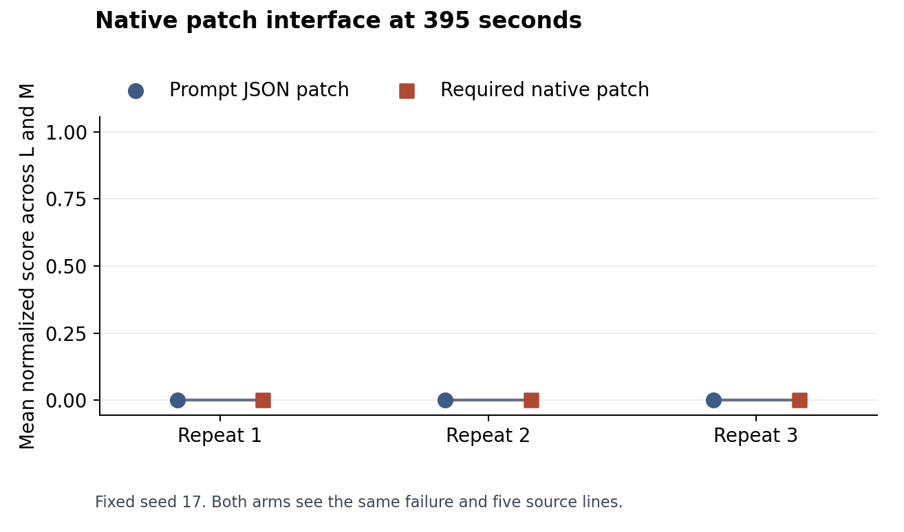

# L/M 原生必选行替换工具实验

结论：**停止原生 `replace_line` ACI 候选。** 在第 395 秒，提示词式 JSON 补丁基线与原生必选工具候选的宏平均分均为 `0.0`；三次跨题配对差均为 `0.0`，配对差样本方差为 `0.0`。预登记的严格正收益门槛未达到，判定 `stop_candidate_no_gain`。

本实验是原创故障恢复诊断，不是正式 PLE 开发集成绩。正式开发集仍没有可报告得分。

## 冻结设置

- 运行：[GitHub Actions 45278770683](https://github.com/songconmaisaix31-design/ple-skill/actions/runs/45278770683)
- 不可变运行提交：[`b5d9defd`](https://github.com/songconmaisaix31-design/ple-skill/tree/b5d9defd791a22ad175d078d7aa6b055881fa73c)
- 协议：[protocol.json](protocol.json)，SHA-256 `60ba06ba5464d9a70e278dedead56068322d59496099310c283e68d50fc5f2ea`
- 输入：未见的 L/M；输入逐文件哈希与离线最优成本写在协议中
- 模型：`google-cloud/gemma-4-26b`，温度 `0`，种子 `17`
- 时间：共同失败程序在 `t=250 s` 释放，真实文件在 `t=395 s` 冻结，名义预算 `720 s`
- 配对：每题三次，同机、独立模型进程和工作区，首臂交替
- 共同信息：两臂收到完全相同的 TypeError、出错行及上下各两行；修复响应上限均为 96 token
- 基线：提示词要求紧凑 JSON，同时保留六个通用工具，`tool_choice=auto`
- 候选：只暴露 `replace_line(line, replacement)`，`tool_choice=required`
- 共同守卫：只允许第 81 行、不带前导缩进的单行替换，重新解析完整程序后才转换为 `run_python`

L3 第一次作业在配对步骤结束后、工件上传期间触发 50 分钟上限，未发布工件，属于技术缺测。只对该整对执行了 [job 138084718355](https://github.com/songconmaisaix31-design/ple-skill/actions/runs/45278770683/job/138084718355) 补跑；其余五对没有重跑。取消尝试记录在 [invalid-attempts.json](attempts/invalid-attempts.json)，主分析固定使用五个第一次有效工件与 L3 的第二次完整工件。

## 从文件独立重评

| 重复 | L JSON 基线 | L 原生工具 | M JSON 基线 | M 原生工具 | 跨题宏配对差 |
|---:|---:|---:|---:|---:|---:|
| 1 | 0.0 | 0.0 | 0.0 | 0.0 | 0.0 |
| 2 | 0.0 | 0.0 | 0.0 | 0.0 | 0.0 |
| 3 | 0.0 | 0.0 | 0.0 | 0.0 | 0.0 |

- 基线宏平均：`0.0`
- 候选宏平均：`0.0`
- 配对差均值：`0.0`
- 配对差样本方差：`0.0`
- L 平均配对差：`0.0`
- M 平均配对差：`0.0`

独立校验器重新核对 L/M 输入哈希，只把第 395 秒工件中的 `schedule.csv` 和 `summary.json` 交给冻结评分器。12/12 臂重评分均为 0 且与运行时记录一致；所有输出目录在截止时都缺少完整的两个文件。



## 接口与语义失败诊断

| 覆盖项 | JSON 补丁基线 | 原生工具候选 |
|---|---:|---:|
| 可重评实验臂 | 6/6 | 6/6 |
| 正确源码曝光 | 6/6 | 6/6 |
| 合法释放/派发时间 | 6/6 | 6/6 |
| 首个修复响应完成 | 6/6 | 6/6 |
| 请求体符合冻结接口 | 6/6 | 6/6 |
| 完成的补丁响应 | 24 | 57 |
| 单一 `replace_line` 响应 | 0 | 57 |
| 参数通过 JSON schema | 0 | 57 |
| 替换文本满足无缩进契约 | 0 | 0 |
| 被宿主接受的补丁 | 0 | 0 |

原生工具消除了 J/K 中“模型选择通用 `run_python`”的问题：六个候选臂的所有实际修复请求都只包含登记的 `replace_line` 并设为必选，57 个完成响应也全部返回该工具且参数满足 schema。然而，57 个替换字符串全部带原行缩进，而协议和工具描述明确说明宿主保留缩进；守卫因此按冻结规则全部拒绝。

这不是只放宽空白就会解决的格式问题。模型尝试的表达式仍是原错误 `sum(c[0] for c in combination)`，或把变量名改成 `item` 后继续对整数下标；即使剥离缩进，语义仍不能修复 TypeError。候选随后收到通用执行器的 `[unknown tool] replace_line` 回执并重复同一错误。结论是：强制最小工具能稳定路由动作，但在当前反馈链中没有形成正确补丁或实际交付。

## 证据与复现

- [逐臂重评分](trials.csv)
- [统计摘要](summary.json)
- [请求、响应与覆盖检查](code-coverage.json)
- [规范化证据包](evidence.zip)，SHA-256 `6bb14431fba26779f3f99849aa23cd1bc6026721cb17dddc002f473338c8332f`
- [六个有效原始工件及哈希](attempts/attempts.json)
- [无效尝试记录](attempts/invalid-attempts.json)

```bash
PYTHONPATH=devtools python devtools/verify_native_patch_evidence.py \
  --archive docs/experiments/native-patch-v1/evidence.zip \
  --protocol docs/experiments/native-patch-v1/protocol.json \
  --settings-protocol docs/experiments/repair-source-v1/protocol.json \
  --csv /tmp/lm.csv --details /tmp/lm-coverage.json

python devtools/native_patch_report.py /tmp/lm.csv \
  --output /tmp/lm-summary.json --plot /tmp/lm.png
```

`evidence.zip` 保留实际提示、请求工具 schema、模型原始返回、补丁判定、输入、截止时交付物和运行记录。生成的替换文本只做结构检查，不在重评机上执行。
