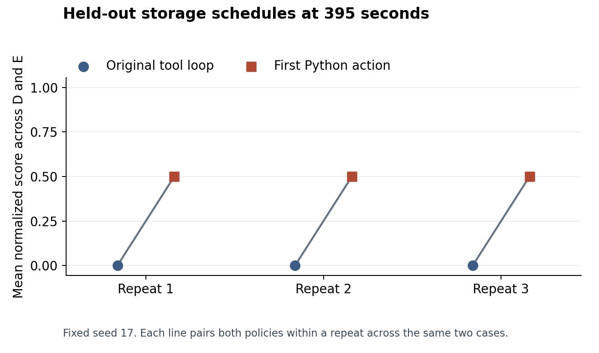

# 首轮 Python 在新调度题上的配对复验

第 395 秒，原工具循环的平均得分为 **0.00**，开启首轮 Python 后为 **0.50**。两道新题各重复三次，六个配对中候选三胜三平。提升全部来自 E。第三方可以用同一评分器读取归档中的文件，复现全部 12 个分数。[冻结协议](https://github.com/songconmaisaix31-design/ple-skill/blob/52dc6b2f683dc5295529843530fe2ee4ea6e1c71/docs/experiments/paired-storage-v1/protocol.json) · [六组云端运行](https://github.com/songconmaisaix31-design/ple-skill/actions/runs/45224002532)

| 留出题 | 基线三次得分 | 首轮 Python 三次得分 | 结果 |
|---|---|---|---|
| D，含停泵时段 | 0、0、0 | 0、0、0 | 两组均未在截止前交齐文件 |
| E，每期泵量必须为正，期末库存固定 | 0、0、0 | 1、1、1 | 候选三次提交的成本均为 121 美分，达到全局最低值 |

| 统计量 | 基线 | 首轮 Python | 配对差（候选减基线） |
|---|---:|---:|---:|
| 三次重复的两题平均分 | 0、0、0 | 0.5、0.5、0.5 | 0.5、0.5、0.5 |
| 均值 | 0.00 | 0.50 | +0.50 |
| 样本方差（分母为 2） | 0.00 | 0.00 | 0.00 |



D 的六次零分都有归档证据。基线三次都尝试导入任务容器未安装的 `pandas`。候选三次都在累加泵量时对整数取下标，抛出 `TypeError` 后未能在第 395 秒前交付。E 的三份候选产物均同时满足逐时段守恒、泵量限制、期末库存和成本要求。[逐次记录](trials.csv) · [机器可读统计](summary.json)

**决策。** 三轮配对平均分差均大于零，D 和 E 的平均分差分别为 0 和 1，符合事先登记的同类任务候选保留规则。三轮方差为零，只说明这两道题在固定种子下重现了相同分数。继续将这个模块用于小型、文件要求明确的 Gemma CPU 开发任务；若更换种子、工程题型或参赛模型，需要新对照。D、E 的结果已经打开，后续针对错误调整时将它们划入开发数据。本次没有测第 720 秒的最终得分，也没有产生正式 PLE 开发集分数。

## 运行与证据

先用原流程和已知校验件打通传输和评分，再冻结实验。历史 A/B/C 用于开发；D/E 在运行前按输入 SHA-256 登记。自变量是首轮 Python 模块整体开关，涉及首轮提示词、输出格式、预算和反馈。这次试验只能对整个模块归因。同一对在同一主机运行，重启模型并重复预热；六对中的三对先运行基线，另外三对先运行候选。Gemma 4 26B A4B 权重、零温度、种子 17、任务容器、评分器、720 秒名义预算和 395 秒取样点固定。[运行时与代码原文](https://github.com/songconmaisaix31-design/ple-skill/tree/52dc6b2f683dc5295529843530fe2ee4ea6e1c71) · [超参数与划分](protocol.json)

证据包按 `题目/重复/策略/` 排列，含原始输入、实际提示词与工具定义、已返回的模型代码、被中断请求的状态、截止点导出的交付物、运行报告及机器信息。已逐一核对 12 个策略运行与冻结协议的校验值，并从文件重新评分，12/12 与云端一致，12/12 份交互记录完整。ZIP 的 SHA-256 为 `511905b2bc72f17b92abf364eade2e2cfd2b060b86419796197f37968b5204e7`。[完整证据包](evidence.zip) · [代码记录覆盖情况](code-coverage.json)

在包含本报告的仓库根目录运行以下命令。生成 PNG 需要 Matplotlib；离线复评分只需 Python 标准库。

```bash
out=docs/experiments/paired-storage-v1
python devtools/verify_paired_storage_evidence.py \
  --archive "$out/evidence.zip" --protocol "$out/protocol.json" \
  --expected-sha 52dc6b2f683dc5295529843530fe2ee4ea6e1c71 --csv /tmp/ple-trials.csv
python devtools/paired_storage_report.py /tmp/ple-trials.csv \
  --output /tmp/ple-summary.json --plot /tmp/ple-paired.png
```
