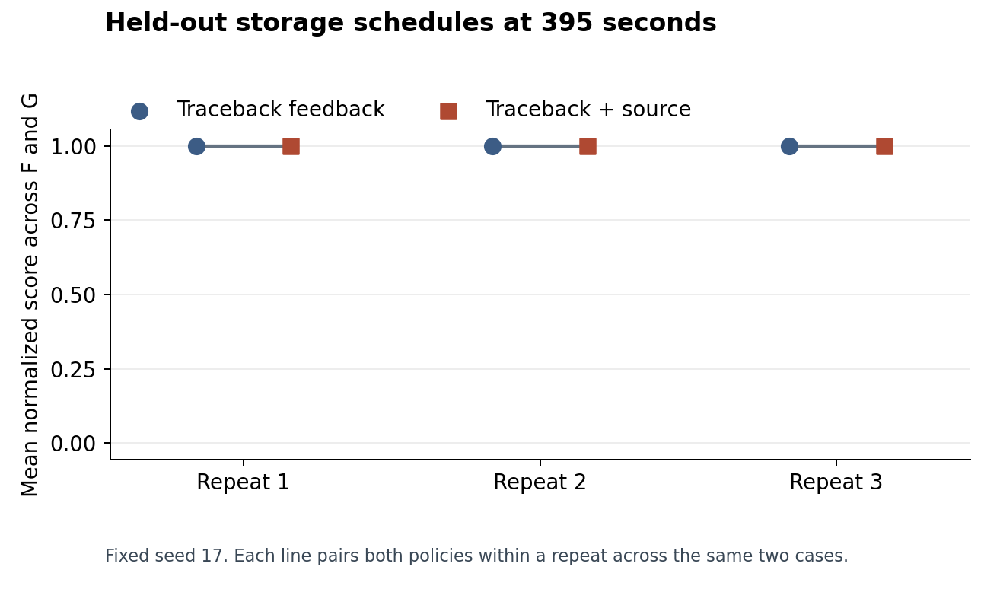

# 修复请求附带源码能否提高第 395 秒交付得分？

**证据不足，保留首轮 Python 基线。** 两种策略均在首次执行程序时完成交付，模型未收到任何带源码片段的修复请求。观察到的平局不能判断源码反馈能否帮助模型修复已出错的程序。 两份原创储水调度留出题 F/G 均完成三次同机配对，基线平均分为 1.00，候选为 1.00，配对平均差为 0.00。归档文件独立复评覆盖 12/12 次运行。[预登记协议](protocol.json) · [云端运行 45232669702](https://github.com/songconmaisaix31-design/ple-skill/actions/runs/45232669702)

## 截止时的实际交付

独立评分器逐期校验泵量、库存和成本，核对 CSV 与 JSON，按参考最低成本除以交付成本计分；截止时没有合规交付计 0。F 的参考最低成本为 77 美分，G 为 110 美分。表中的“收到源码”按实际发给模型的修复消息逐条核对。

| 题目 | 重复 | 先运行 | 基线分 | 候选分 | 交付成本，基线 / 候选（美分） | 候选收到源码 |
|---|---:|---|---:|---:|---:|---:|
| F | 1 | 基线 | 1.00 | 1.00 | 77 / 77 | 0 |
| G | 1 | 候选 | 1.00 | 1.00 | 110 / 110 | 0 |
| F | 2 | 候选 | 1.00 | 1.00 | 77 / 77 | 0 |
| G | 2 | 基线 | 1.00 | 1.00 | 110 / 110 | 0 |
| F | 3 | 基线 | 1.00 | 1.00 | 77 / 77 | 0 |
| G | 3 | 候选 | 1.00 | 1.00 | 110 / 110 | 0 |

每次重复先取 F/G 两题的平均分，再用三次重复计算均值和样本方差（分母为 2）。F、G 的平均配对分差分别为 0.00 和 0.00。固定种子的重复只衡量当前两个输入下的执行稳定性，分数相同也允许模型返回不同代码。

| 统计对象 | 第一次 | 第二次 | 第三次 | 均值 | 样本方差 |
|---|---:|---:|---:|---:|---:|
| 基线 | 1.00 | 1.00 | 1.00 | 1.00 | 0.00 |
| 候选 | 1.00 | 1.00 | 1.00 | 1.00 | 0.00 |
| 候选减基线 | 0.00 | 0.00 | 0.00 | 0.00 | 0.00 |



基线发出失败修复请求 0/6 次，候选 0/6 次。候选实际收到源码片段 0/6 次。两组分别有 6/6 和 6/6 次在截止时交齐两份文件。成功执行后发起的结果核查单独记录。[原始分数及文件数](trials.csv) · [配对统计](summary.json) · [模型交互及代码覆盖](code-coverage.json)

## 比较与决策

两组共用已冻结的首轮 Python 策略。首轮程序非零退出，且可可靠定位到该程序的异常行时，候选在原修复消息末尾添加该行及上下各两行、最多 800 字符。其余设置一致。模型为 Gemma 4 26B A4B（UD-IQ2_XXS，llama.cpp b12651），温度 0，种子 17。每对在同一台云端 CPU 上先后执行，臂间重启模型并重新预热，三个配对先运行基线，另三个先运行候选。任务声明预算 720 秒，主指标只取第 395 秒快照。A–E 用于开发，F/G 在推理前冻结题面与输入哈希。[运行与评分代码 9c1a00a](https://github.com/songconmaisaix31-design/ple-skill/tree/9c1a00a40c8e40212ea1e97c93824366889ddb8e) · [划分、权重哈希与超参数](protocol.json)

预登记要求六对均取得可重评分数、至少一次候选实际收到源码、三个重复的平均分差均为正，且逐题平均分差均非负，才扩大同类验证。本轮登记判定为 `inconclusive_no_exposure`。两题现已进入后续开发数据。[后续实验计划](../next-round.md)

本轮只测原创调度诊断。正式 PLE 开发题的最近一次尝试在受限数据授权阶段收到 `invalid_grant`，官方评分步骤跳过，尚无正式成绩。[正式任务运行](https://github.com/songconmaisaix31-design/ple-skill/actions/runs/45204574378/job/137796706042)

## 技术补跑与复现

G3 首次候选在启动模型时退出，现场无分数；随后同机基线得到 1.00。首次尝试的 12 份记录全部保留。按预登记规则，仅在同一代码版本上补跑 G3 整对。主分析取首次尝试的 F1–F3、G1–G2，以及第二次尝试的 G3 两臂。首次 G3 的孤立基线可在原始记录中复查。[首次尝试及各任务链接](attempts/attempt-1.json) · [首次逐次分数](attempts/attempt-1.csv) · [G3 补跑 137913411809](https://github.com/songconmaisaix31-design/ple-skill/actions/runs/45232669702/job/137913411809)

归档保存实际输入、请求与已返回的模型代码、未完成的调用状态、第 395 秒交付文件、模型和运行器元数据。[首次证据](attempts/attempt-1-evidence.zip) · [补跑证据](attempts/attempt-2-evidence.zip) · [主分析证据](evidence.zip)

| ZIP | SHA-256 |
|---|---|
| 完整 6 对 | `207de0f22db5149342910601c1cbd84bd4a7d5624d505779aca76bf735111a08` |
| 首次尝试 | `7cc6c7ed0a3b776879e72fd687aea5367baa268914b41fecfb58603eee538240` |
| G3 整对补跑 | `0a8c484523db71104888031f7fa083e10aec8e01fb82310a2bd3e3d004f5bee3` |

在包含本报告的分支根目录运行，复评只需 Python 标准库。使用 `--plot` 生成图时需要 Matplotlib。

```bash
out=docs/experiments/repair-source-v1
tmp=$(mktemp -d)
python devtools/rebuild_repair_source_evidence.py \
  --first "$out/attempts/attempt-1-evidence.zip" --retry "$out/attempts/attempt-2-evidence.zip" \
  --protocol "$out/protocol.json" --output "$tmp/evidence.zip"
python devtools/verify_paired_storage_evidence.py \
  --archive "$tmp/evidence.zip" --protocol "$out/protocol.json" \
  --expected-sha 9c1a00a40c8e40212ea1e97c93824366889ddb8e \
  --csv "$tmp/trials.csv" --details "$tmp/code-coverage.json"
python devtools/paired_storage_report.py "$tmp/trials.csv" \
  --protocol "$out/protocol.json" --output "$tmp/summary.json" --plot "$tmp/paired-scores.png"
```
