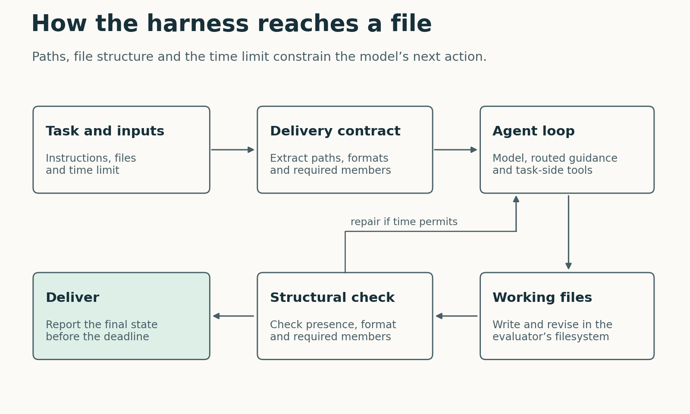
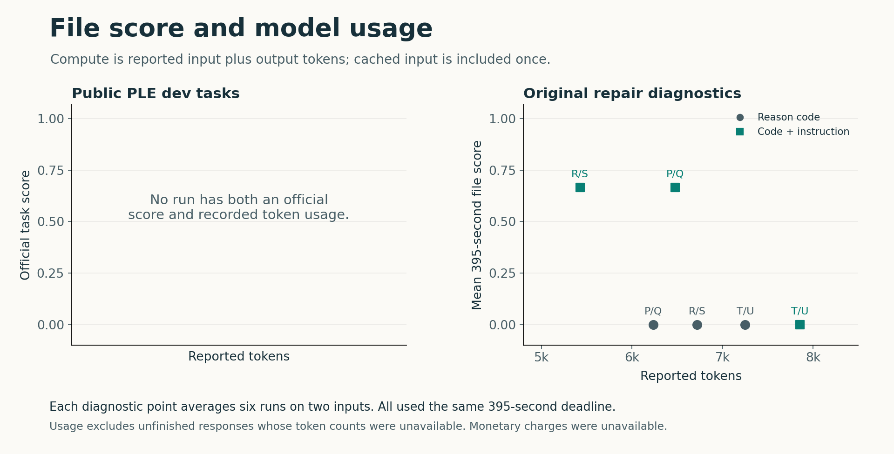
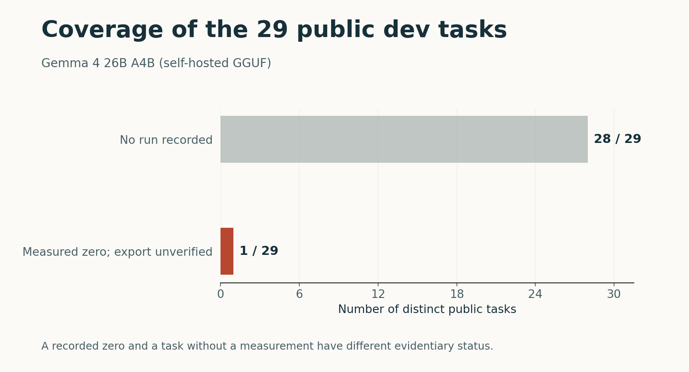

**Entry commit** — Insert the 40-character SHA of the submitted code and artifacts after that commit exists.

# What reaches the file? A controlled study of agent repair and file delivery

A small change to a tool response helped an engineering agent finish four of six pump-scheduling runs on each of two pairs of held-out inputs. On a different programming error, the same change yielded five accepted edits and zero working deliveries. This difference emerged when we scored the files on disk at a fixed deadline. It would have been easy to miss by counting successful tool calls.

These experiments use original scheduling problems. On the public PLE development set, our first recorded Gemma run scored 0.000 on one task. Its export could not be independently regraded from that attempt. The remaining 28 tasks lack a score in this evidence set.

## From instructions to an engineering deliverable

Our harness extracts the paths, file types and archive members requested in the task instructions. It gives the model this checklist, the available tools and guidance for the engineering discipline. The model can inspect inputs, run calculations and write files inside the task workspace. A separate structural check looks for missing files, unreadable documents and mismatched headers. The model can revise files until the deadline. Calculations and engineering judgments remain the model’s responsibility.

Consider the public structural task named *wind-diaphragm-shear*. A diaphragm carries lateral forces across a floor or roof to the vertical elements that resist them. A practicing engineer would trace that path, identify the relevant supports and loading assumptions, calculate the resulting forces and record enough intermediate quantities for review. In our first run, the automated checks awarded zero and the evaluator subsequently exited with status 1. The public run record did not preserve a reviewable exported solution. It cannot tell us whether the agent missed a support, made a units error or failed to deliver a readable calculation. Keeping the working files and a record of the final export is necessary to distinguish those failures. [Public run](https://github.com/songconmaisaix31-design/ple-skill/actions/runs/45337685121/job/138253542503) · [Engineering background, NIST](https://nvlpubs.nist.gov/nistpubs/gcr/2016/NIST.GCR.16-917-42.pdf)

## Which repairs produce a working file?

We isolated one decision in a smaller task. A model had to repair a failed Python program that generated a pump schedule. Both arms received the same failed program at 250 seconds, the same five-line excerpt, a single-line replacement tool and one immediate retry for a rejected edit. The baseline returned a machine-readable rejection reason. The candidate also gave a short instruction explaining how to correct the format. For example, the host already preserved indentation, so a replacement had to start with the first character of the code.

We froze each new input pair before running it. For each input we ran three alternating-order pairs on the same machine, using Gemma 4 26B A4B, temperature zero, seed 17 and a 96-token repair limit. We rescored the actual files at 395 seconds. The scorer checked whether the submitted schedule was feasible and reached the reference cost. Repetitions used the same seed, so the reported variability captures run-to-run differences under that seed.

| Frozen inputs and failure | Baseline full-score runs | Candidate full-score runs | Paired gain by repetition, averaged over both inputs | Mean gain | Sample variance of gain |
|---|---:|---:|---|---:|---:|
| P/Q, type error | 0/6 | 4/6 | +0.5, +0.5, +1.0 | +0.667 | 0.0833 |
| R/S, same type error, fresh inputs | 0/6 | 4/6 | +0.5, +0.5, +1.0 | +0.667 | 0.0833 |
| T/U, undefined variable, fresh inputs | 0/6 | 0/6 | 0, 0, 0 | 0 | 0 |

On T/U the candidate produced an accepted replacement on five runs. All five replacements referred to another undefined variable and failed when the program ran. The simple instruction fixed the representation of a patch. It supplied no information about which variable held the intended pump quantity. We stopped expanding this intervention after it failed the preregistered requirement for positive gains in every repetition. [P/Q](https://github.com/songconmaisaix31-design/ple-skill/actions/runs/45324245738) · [R/S](https://github.com/songconmaisaix31-design/ple-skill/actions/runs/45330869706) · [T/U](https://github.com/songconmaisaix31-design/ple-skill/actions/runs/45337689208)

## What did the model spend?

On R/S the baseline used a mean of 6,720 reported input plus output tokens per run. The instruction arm used 5,426 and completed four schedules. On T/U it used 7,856 versus 7,251 for the baseline and completed none. The host counted tokens returned by the model server. Cached inputs appear once in that total. An interrupted response can consume additional compute without returning usage. We have no billing records for these runs. Figure 2 uses measured tokens, with no conversion to currency. We held the deadline fixed across arms, so these points do not determine an accuracy plateau or predict the score available at a higher budget.

## How far do the results transfer?

| Model and role | Public PLE development evidence in this snapshot | Original paired diagnostics |
|---|---|---|
| Gemma 4 26B A4B, local GGUF on a GitHub Actions CPU | One checks-only task scored 0.000; no LLM judge was required | 36 scored arms across P/Q, R/S and T/U |
| GLM 5.2, repository-declared target at the time of analysis | No comparable scored run recorded | No matched comparison on these inputs |

A full 29-task cross-model comparison remains unmeasured. Figure 3 counts distinct public tasks. The one measured zero has a published evaluator log. The other 28 lack an observed task outcome. Neither a competition-wide score nor a hidden-test ranking follows from these observations.

